<p align="center">
  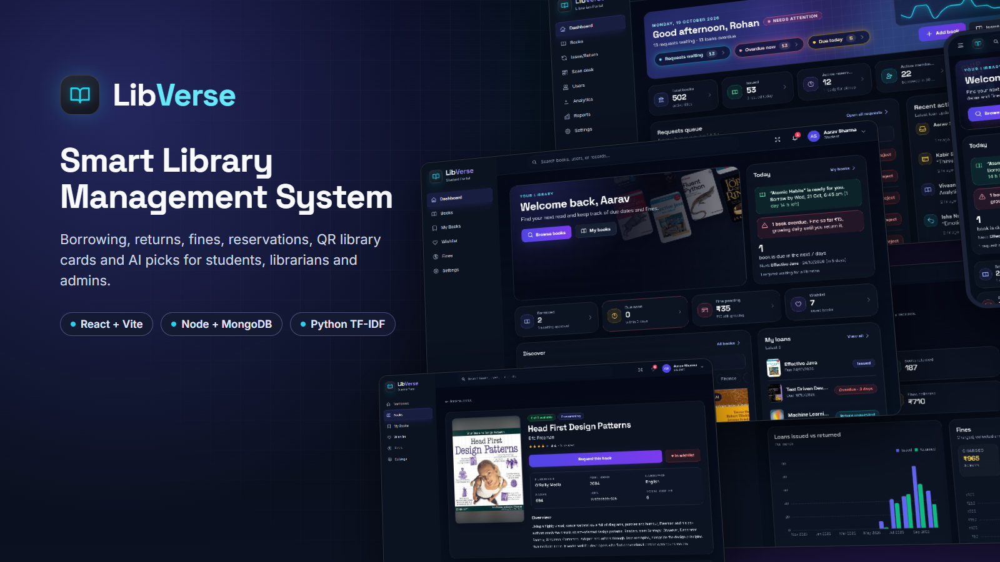
</p>

<h1 align="center">LibVerse — Smart Library Management System</h1>

<p align="center">
  Borrowing, returns, fines, reservations, QR library cards and AI book picks in one app for students, librarians and admins.
</p>

<p align="center">
  <a href="https://github.com/Vishesh233/LibVerse/actions/workflows/ci.yml"></a>
  
  
  
  
</p>

<p align="center">
  <b>Live demo:</b> <i>coming soon</i> &nbsp;·&nbsp;
  <a href="docs/SCREENSHOTS.md">All screenshots</a> &nbsp;·&nbsp;
  <a href="DEPLOYMENT.md">Deploy your own</a> &nbsp;·&nbsp;
  <a href="docs/API.md">API</a> &nbsp;·&nbsp;
  <a href="docs/ARCHITECTURE.md">Architecture</a>
</p>

---

## What it is

LibVerse runs a college or community library end to end. Students find books, request them, renew,
reserve when every copy is out, and pay late fines by UPI. Librarians approve requests, work the
counter with a QR scan desk and keep the catalogue in shape. Admins see the whole library in
dashboards, reports and an audit log. A small Python service suggests books to each student and
says why ("Because you read *Clean Code*").

## Screens

| Student dashboard | Librarian dashboard |
|---|---|
| 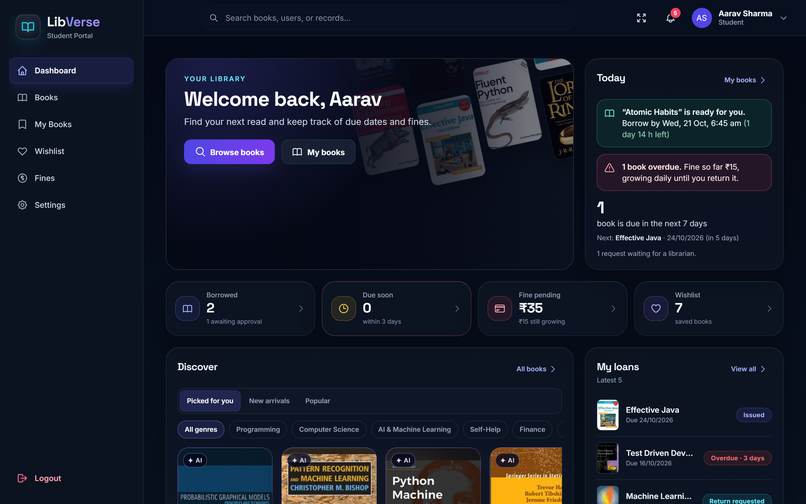 | 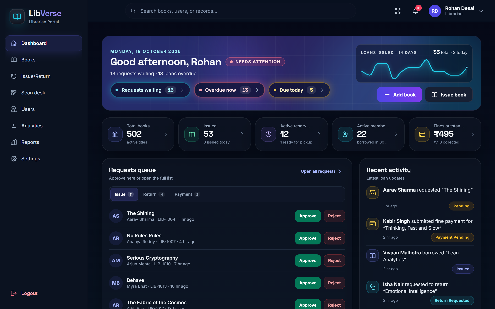 |
| **Book details** | **Books table** |
| 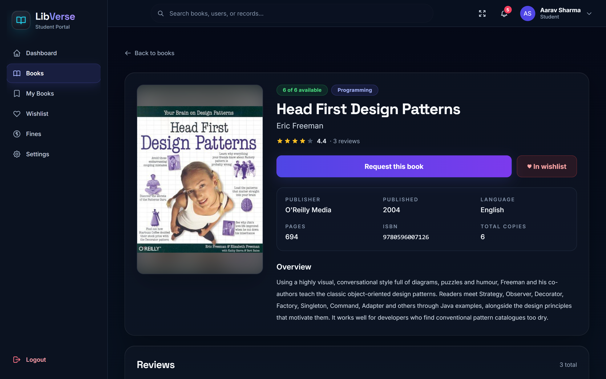 | 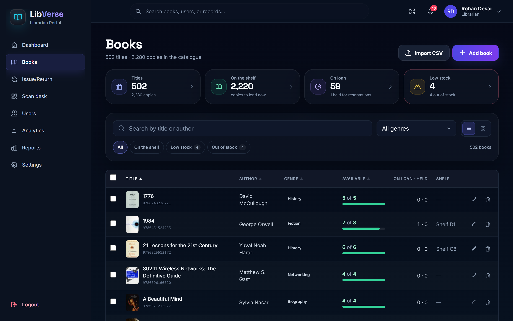 |
| **Fines and UPI payment** | **Reports** |
| 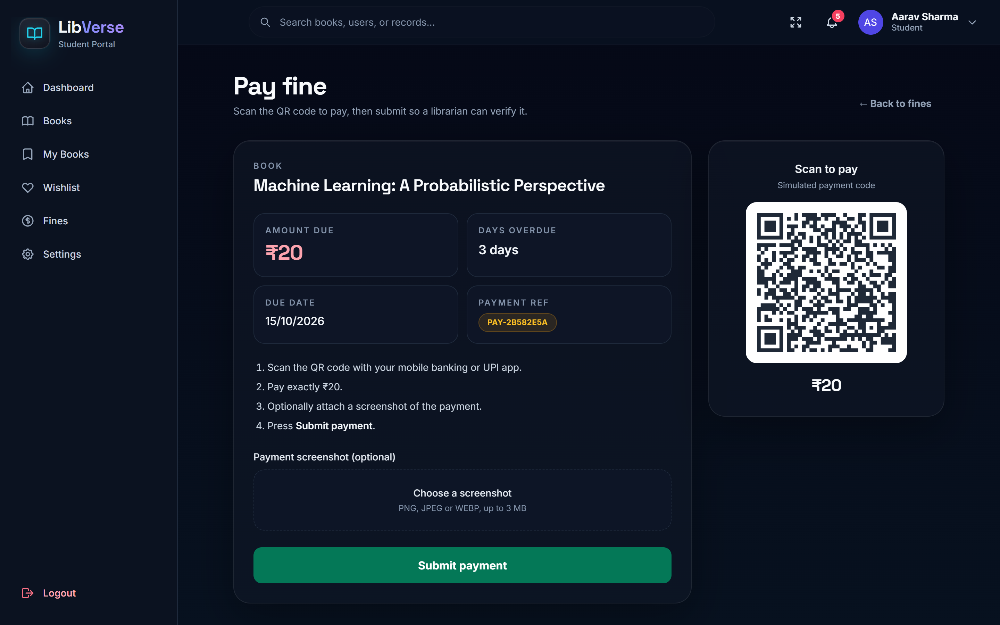 | 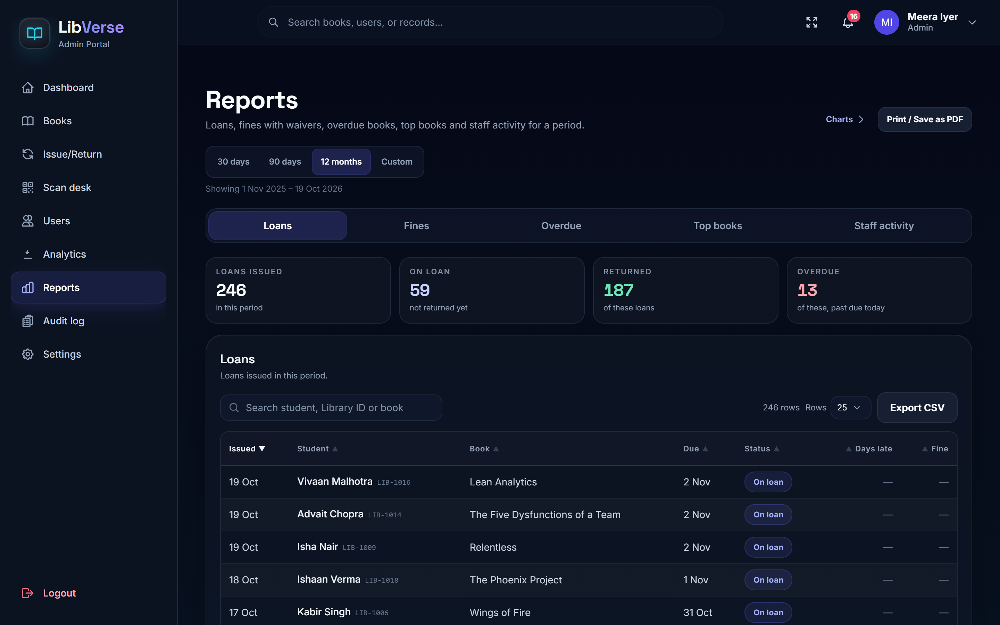 |

<p align="center">
  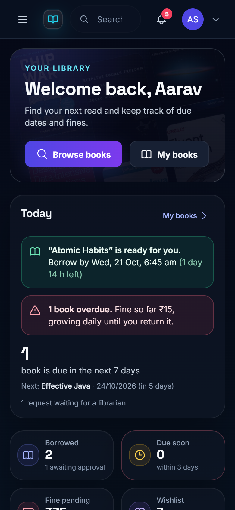
  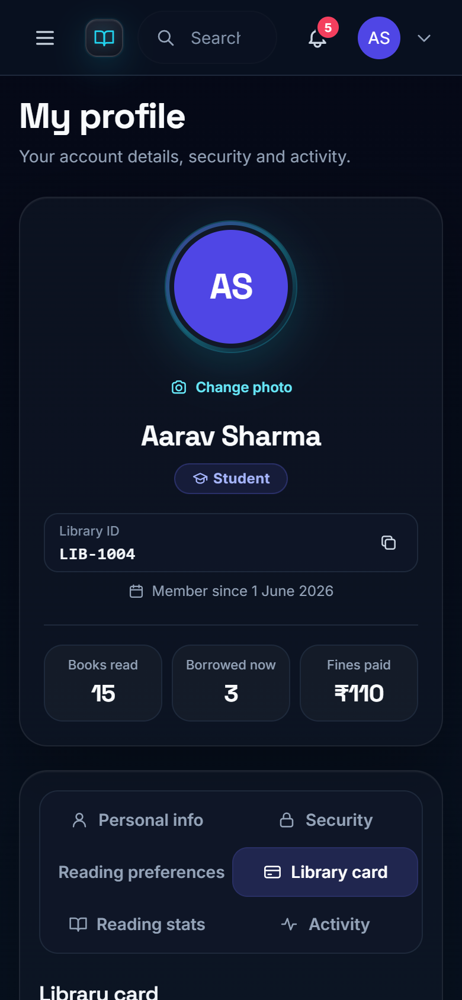
  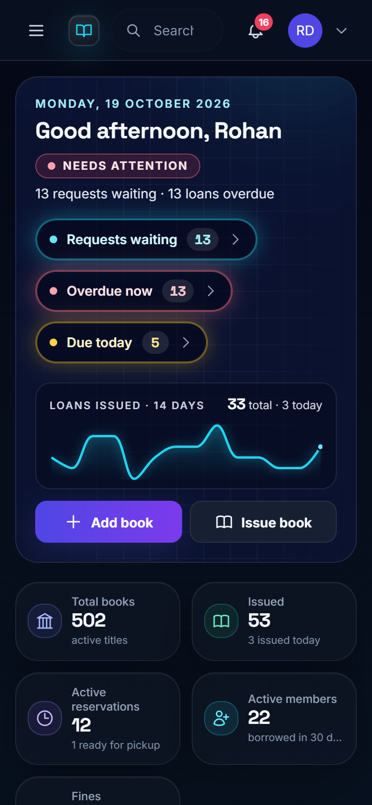
</p>

Every screen, grouped by role: [docs/SCREENSHOTS.md](docs/SCREENSHOTS.md) (or open `docs/gallery.html` locally).

## Features by role

**Students**
- Dashboard with what is due, overdue fines building up, books ready to collect and "Picked for you" suggestions with reasons
- Catalogue of 500+ books with search, genre and availability filters; book pages with reviews
- Request, renew (up to 3 times, 7 days each) and return; history of every loan
- Reservations: join the waiting list when every copy is out; a returned copy is held for 48 hours
- Wishlist with back-in-stock alerts; notifications for every step
- Fines at ₹5 per day late; pay by UPI QR and upload the receipt
- Digital library card with a signed QR code (download as PNG or print); reading stats; favourite genres
- Forgot password by a 6-digit email code (when email is configured)

**Librarians**
- Control-room dashboard: requests waiting, overdue now, due today, 14-day trend, recent activity
- Requests queue: approve or reject issues, approve returns, verify fine payments, waive fines with a reason
- Issue & return at the counter, and a scan desk (card QR + book QR) for issuing and returning in seconds
- Books table with sortable columns, stock "X of Y", low-stock filter, bulk QR labels / CSV export / removal
- Bulk CSV import with a row-by-row preview (genre, ISBN-13 and duplicate checks) and optional cover lookup
- Users table with loans, overdue and fines per member; Student 360 page with actions; find a student by Library ID

**Admins**
- Everything librarians can do, plus staff accounts and roles, library card reissue and the audit log
- Analytics (borrowing trends, genres, members) and reports (loans, fines with waivers, overdue, top books, staff activity) with CSV export

## Tech stack

| Part | Technology |
|---|---|
| Frontend | React 18, Vite, Tailwind CSS, React Router, ECharts (lazy loaded), framer-motion; route-level code splitting |
| API | Node.js, Express, Mongoose (MongoDB), GridFS for uploaded images, sharp, nodemailer |
| Recommendations | Python, Flask, scikit-learn (TF-IDF) |
| Security | helmet with a Content-Security-Policy, CORS allowlist, express-rate-limit, bcrypt, JWT with session versioning |
| Quality | Jest + Supertest against a real MongoDB, pytest, GitHub Actions |
| Hosting | Vercel (frontend), Render (API and AI service), MongoDB Atlas — see [DEPLOYMENT.md](DEPLOYMENT.md) |

## Architecture

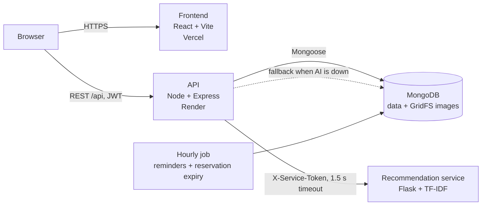

The API never waits on the AI service for more than 1.5 seconds: when it is down, slow or not configured,
"Picked for you" uses genre-based suggestions from MongoDB instead. More in [docs/ARCHITECTURE.md](docs/ARCHITECTURE.md).

## Run it locally

You need **Node.js 20+**, **MongoDB** running on `127.0.0.1:27017`, and optionally **Python 3.11** for the AI service.

```bash
git clone https://github.com/Vishesh233/LibVerse.git
cd LibVerse

# 1. API
cd backend
cp .env.example .env          # then set JWT_SECRET to a long random string
npm install
npm run dev                   # http://localhost:5001  (health: /api/health)

# 2. Frontend (new terminal)
cd frontend
cp .env.example .env          # VITE_API_BASE_URL=http://localhost:5001/api
npm install
npm run dev                   # http://localhost:3000

# 3. Optional: AI recommendations (new terminal)
cd ai-service
python -m venv venv
venv\Scripts\activate         # macOS/Linux: source venv/bin/activate
pip install -r requirements.txt
cp .env.example .env          # set AI_SERVICE_TOKEN; put the same value in backend/.env
python app.py                 # http://127.0.0.1:5000
```

On Windows PowerShell use `Copy-Item .env.example .env` instead of `cp`.

Every setting is explained in `backend/.env.example`, `frontend/.env.example` and `ai-service/.env.example`.
Email ("Forgot password") turns on only when all of `SMTP_HOST`, `SMTP_PORT`, `SMTP_USER`, `SMTP_PASS` and `MAIL_FROM` are set.

**Data to try it with:** `node backend/scripts/seedDemo.js` fills a separate database, `libverse_demo`,
with the catalogue and four months of fictional activity. Point the API at it with
`MONGODB_URI=mongodb://127.0.0.1:27017/libverse_demo` and sign in as `aarav.sharma@example.com`
(student), `rohan.desai@example.com` (librarian) or `meera.iyer@example.com` (admin), password
`Demo#Library2026`. These accounts exist only in the demo database. `node backend/scripts/seedDemo.js --drop` removes it.

To create the first admin in your own database: `cd backend && npm run create-admin`.

## Scripts

Run from `backend/` unless noted. Scripts that change data do a dry run first and need `--apply`.

| Command | What it does |
|---|---|
| `npm run dev` / `npm start` | API with reload / API |
| `npm test` | Backend tests (needs `MONGODB_URI_TEST`, see below) |
| `npm run create-admin` | Create an admin; asks for the password without showing it |
| `npm run catalogue:export` / `catalogue:import` | Copy the catalogue to a new, empty database (e.g. Atlas) |
| `node scripts/seedDemo.js [--drop]` | Recreate (or drop) the demo database `libverse_demo` |
| `node scripts/recountStock.js [--apply]` | Recompute every book's stock counters from loans and reservations |
| `node scripts/resetPassword.js <email>` | Set a new password for one account |
| `node scripts/migrateUploadsToGridFS.js [--apply]` | Move old `backend/uploads` images into GridFS |
| `node scripts/applyDescriptionRewrite.js [--apply]` | Apply the catalogue description/ISBN/year clean-up |
| `node scripts/screenshots/run.mjs` (repo root) | Regenerate every screenshot, showcase image, `docs/gallery.html` and `docs/SCREENSHOTS.md` |

`node scripts/screenshots/run.mjs` seeds `libverse_demo`, builds the frontend, starts the API (and the
AI service if `ai-service/venv` exists) on spare ports, captures every screen with headless Edge or
Chrome (set `EDGE_PATH` if neither is found), renders the images in `docs/showcase/` and drops the
demo database at the end. It never touches your own database or running dev servers.

## Tests and CI

```bash
cd backend && MONGODB_URI_TEST=mongodb://127.0.0.1:27017/libverse_jest_test npm test   # Jest + Supertest
cd ai-service && pip install -r requirements-dev.txt && python -m pytest             # pytest
cd frontend && npm run build                                                          # build check
```

The test database name must end in `_test`; it is emptied on every run. GitHub Actions runs all three on
every push and pull request (MongoDB service container, dummy secrets). Details: [docs/TESTING.md](docs/TESTING.md).

## Security notes

- Passwords hashed with bcrypt; JWTs carry a token version, so changing or resetting a password signs out every other session
- Role checks on every staff route; librarians cannot see or change admin accounts
- helmet with a Content-Security-Policy written for this app (Google Fonts, Open Library covers, the API origin), CORS allowlist, `X-Powered-By` off
- Rate limits on login, sign-up, password change, forgot-password and reset-code entry
- Forgot-password codes: same answer whether or not the email exists, stored only as an HMAC, 10-minute expiry, 5 guesses
- Fine totals and stock counters updated atomically; a library card QR is signed and stops working when reissued
- The audit log records staff actions without emails or passwords; the AI service needs a shared token and keeps no student data
- Never commit `.env` files; production secrets live only in the host's settings (see [DEPLOYMENT.md](DEPLOYMENT.md))

## How the recommendations work

The AI service ([`ai-service/`](ai-service/README.md)) builds a word-level **TF-IDF** model
(unigrams + bigrams, English stop words removed) over each book's title, author, genre and
description. For a student, every candidate book is compared with each book they have read; the
closest match becomes the explanation, **"Because you read …"**. Favourite genres add a small bonus,
and books in a favourite genre with no content match are ranked by popularity as
**"Popular in &lt;genre&gt;"**. Books the student has read, borrowed, requested or reserved are never suggested.

The API sends the catalogue to the service when it starts and again a few seconds after any book is
added, edited or removed. Each dashboard request has a 1.5-second budget; the response says whether
the picks came from the AI (`source: "ai"`, shown with an **AI** badge) or from the MongoDB fallback.

## Project layout

```
backend/      Express API: routes, controllers, services, models, jobs, scripts, tests
frontend/     React app: pages, components, hooks, services/api.js
ai-service/   Flask recommendation service with pytest tests
docs/         API, architecture, testing, screenshots, showcase images, gallery
scripts/      screenshots/: one command for every image in docs/
render.yaml   Render services (API + AI)       DEPLOYMENT.md   step-by-step deployment
```

## Deploying

[DEPLOYMENT.md](DEPLOYMENT.md) walks through MongoDB Atlas, Render (API and AI service), Vercel,
seeding the catalogue, creating the first admin and a post-deploy checklist.
