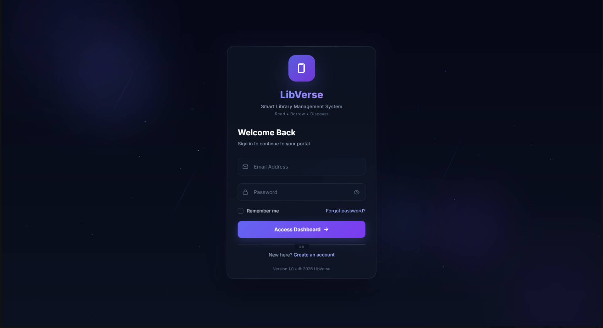
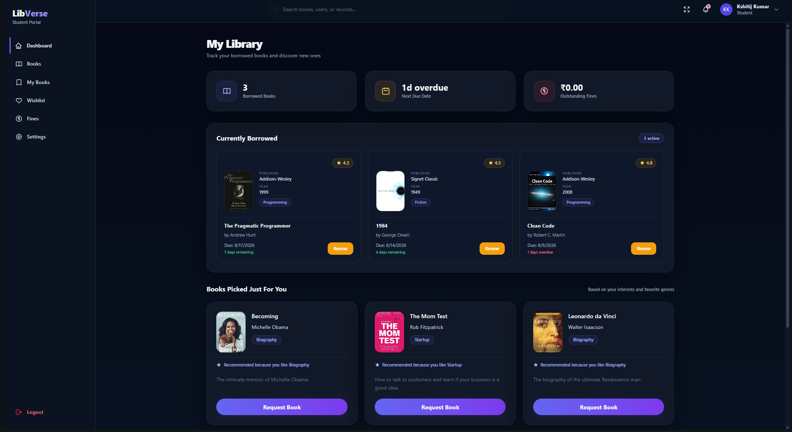
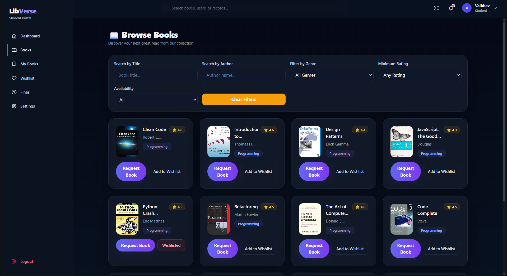
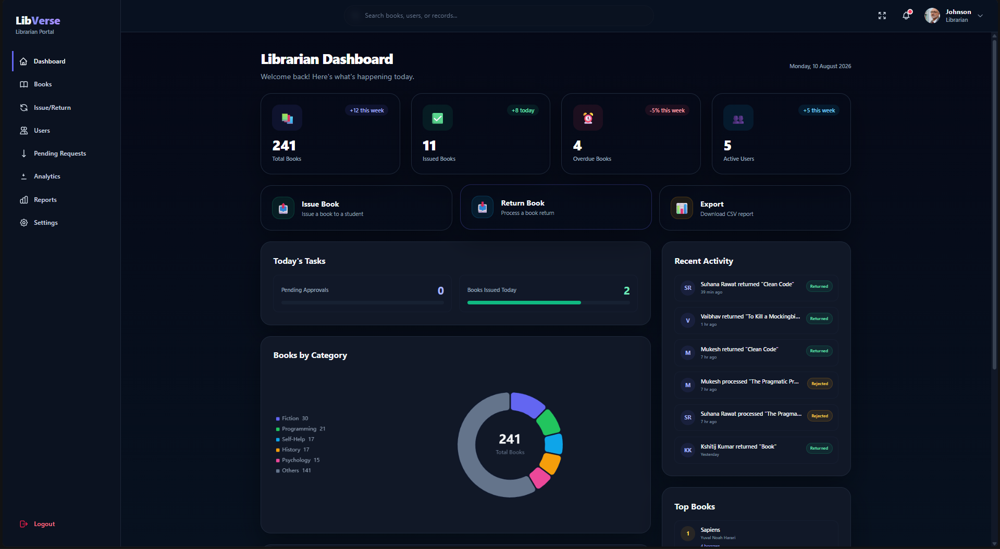

<h1 align="center">📚 LibVerse — Smart Library Management System</h1>

  

  <strong>A modern full-stack library management platform for Students, Librarians & Super Admins.</strong>

  
  
  
  

---

# 🌌 About LibVerse

**LibVerse** is a full-stack Smart Library Management System designed to digitize and simplify the complete library management workflow.

The system provides dedicated role-based portals for:

- 🎓 Students
- 📚 Librarians
- 🛡️ Admins

From discovering books and managing wishlists to issuing books, processing returns, calculating overdue fines, handling QR-based payments, sending notifications, and viewing analytics — LibVerse brings the complete library workflow into one platform.

---

# ✨ Core Highlights

| Module | Features |
|---|---|
| 🔐 Authentication | JWT authentication, protected routes, role-based access |
| 👥 User Management | Student, Librarian & Super Admin roles |
| 📚 Book Management | Add, edit, delete, search and filter books |
| 🔎 Smart Search | Search by title, author and book information |
| 🏷️ Filtering | Category, rating and availability filters |
| ⭐ Ratings | Dynamic 0–5 book ratings |
| ❤️ Wishlist | Personal wishlist management |
| 📖 Circulation | Issue, approve, return and renew books |
| 💰 Fine Management | Automatic overdue fine calculation |
| 💳 QR Payment | QR-based fine payment and librarian verification |
| 🔔 Notifications | User-specific system notifications |
| 🖼️ Cover Management | Upload, URL, ISBN fallback and placeholder |
| 🤖 Recommendations | TF-IDF and cosine similarity based recommendations |
| 📊 Analytics | KPI cards and interactive charts |
| 👤 Profile | Name, avatar and password management |

---

# 🎓 Student Portal

The Student Portal provides students with everything required to discover, borrow and manage books.

- 📚 Browse, search and filter books by category, rating and availability
- 📖 View book details, ratings and availability
- 📥 Request, return and renew books
- 💰 Track due dates and overdue fines with QR payment
- ❤️ Manage wishlist and receive AI-powered recommendations
- 👤 Manage profile, avatar, password and notifications
---

# 📚 Librarian Portal

The Librarian Portal handles the day-to-day operations of the library.

- 📊 View library analytics and activity
- 📚 Add, edit, delete, search and filter books
- 👥 Manage students and issue requests
- 📖 Issue, return and approve books
- 💰 Manage fines and verify QR payment requests
- 🔔 Receive payment and circulation notifications
---

# 🛡️ Admin Portal

The Super Admin has system-level control over the entire application.

- 📊 Monitor system-wide analytics and reports
- 👥 Manage users and accounts
- 📚 Manage, search and filter books
- 🔄 Monitor issue, return and transaction activity
- 💰 Monitor fines and payment activity
- 🔐 Manage role-based administration and notifications

---

# 📖 Book Management

LibVerse provides complete CRUD-based book management with:

- 📚 Book details including title, author, ISBN, category, publisher and description
- 📦 Copy and availability tracking
- ⭐ Ratings
- 🖼️ Cover image and URL support
- 🔎 Search and filtering
- ✏️ Create, update and delete operations
---

# 🖼️ Smart Book Cover System

LibVerse supports multiple sources for book cover images.

The application follows this fallback chain:

    1. Uploaded Cover Image
             ↓
    2. Image URL
             ↓
    3. OpenLibrary ISBN Cover
             ↓
    4. Default Placeholder

This prevents broken image icons when a particular image source is unavailable.

---

# 🔄 Book Circulation & Fine Payment

LibVerse provides a controlled issue, return and fine-payment workflow.

Student requests a book → Librarian approves → Book issued → Student returns.

For overdue books:

Return → ₹5/day fine → QR payment → Librarian verification → Fine paid → Book returned.

All issue, return, fine and payment statuses are tracked through the transaction system.

---

# 🔔 Notification System

LibVerse provides user-specific notifications.

Notifications may be generated for:

- 📥 Book Requested
- ✅ Book Approved
- 🔄 Book Returned
- 💰 Fine Generated
- 💳 Payment Pending
- ✅ Payment Approved
- 📚 Circulation Updates
- 👤 Account Updates

Notifications are associated with the relevant user rather than being sent globally.

---
# 🖥️ Application Preview

### 🔐 Login Page

  

### 🎓 Student Dashboard

  

### 📚 Book Portal

  

### 📚 Librarian Dashboard

  

---

# 🤖 AI Recommendation Engine

LibVerse uses a dedicated Python recommendation service based on
TF-IDF vectorization and cosine similarity.

The system uses book metadata, reading history and genre preferences
to generate relevant recommendations.

### Recommendation Pipeline

    Available Books
          ↓
    Book Metadata
          ↓
    TF-IDF Vectorization
          ↓
    Cosine Similarity
          ↓
    Recommended Books

The AI service is separated from the Node.js backend to keep recommendation logic modular.

---

# 📊 Analytics Dashboard

LibVerse provides interactive analytics for library management.

- Total and available books
- Issued books and active users
- Transactions and pending requests
- Fine statistics and library activity

Visualizations include Bar Charts, Spline/Line Charts, Doughnut Charts and KPI Cards.

---

# 🧩 System Architecture

LibVerse follows a modular full-stack architecture.

    ┌──────────────────────────┐
    │       React Frontend     │
    │                          │
    │ Pages • Components       │
    │ Hooks • Context • UI     │
    └────────────┬─────────────┘
                 │
                 │ REST API
                 ▼
    ┌──────────────────────────┐
    │    Node.js + Express     │
    │                          │
    │ Routes • Controllers     │
    │ Middleware • Services    │
    └────────────┬─────────────┘
                 │
        ┌────────┴────────┐
        │                 │
        ▼                 ▼
    ┌───────────┐    ┌───────────────┐
    │  MongoDB  │    │ Python Flask  │
    │           │    │ AI Service    │
    └───────────┘    └───────┬───────┘
                              │
                              ▼
                       Recommendations

---

## 🛠️ Technology Stack

<table align="center">
<tr>
<td align="center" width="50%">
<h3>🎨 Frontend</h3>

</td>

<td align="center" width="50%">
<h3>⚙️ Backend</h3>

</td>
</tr>

<tr>
<td align="center">
<h3>🤖 AI / ML</h3>

</td>

<td align="center">
<h3>🧰 Tools</h3>

</td>
</tr>
</table>

---

# 📁 Project Structure

    smart-library-system/
    ├── frontend/              # React + Tailwind frontend
    │   ├── src/
    │   │   ├── components/    # Reusable UI components
    │   │   ├── pages/         # Application pages
    │   │   ├── context/       # Global state
    │   │   ├── hooks/         # Custom React hooks
    │   │   ├── services/      # API services
    │   │   └── utils/         # Frontend utilities
    │   └── package.json
    │
    ├── backend/               # Node.js + Express backend
    │   ├── controllers/       # Business logic
    │   ├── models/            # MongoDB/Mongoose models
    │   ├── routes/            # API routes
    │   ├── middleware/        # Authentication & middleware
    │   ├── services/          # Backend services
    │   ├── utils/             # Helper utilities
    │   └── server.js
    │
    ├── ai-service/            # Python Flask recommendation service
    │   ├── model/
    │   ├── routes/
    │   ├── utils/
    │   └── app.py
    │
    ├── docs/                  # Project documentation
    ├── package.json
    ├── QUICKSTART.md
    └── README.md

---

# ⚙️ Installation & Setup

## Prerequisites

Make sure the following are installed:

- Node.js
- npm
- Python 3.8+
- MongoDB
- MongoDB Compass
- Git

---

# 1️⃣ Clone Repository

    git clone <repository-url>
    cd smart-library-system

---

# 2️⃣ Backend Setup

    cd backend
    npm install

Create/configure the backend `.env` file:

    MONGODB_URI=your_mongodb_connection_string
    JWT_SECRET=your_jwt_secret
    JWT_EXPIRE=your_jwt_expiration
    PORT=5001
    AI_SERVICE_URL=http://localhost:5000
    NODE_ENV=development

Start the backend:

    npm run dev

Backend:

    http://localhost:5001

---

# 3️⃣ Frontend Setup

Open a new terminal:

    cd frontend
    npm install

Start the frontend:

    npm run dev

Vite will provide the local development URL in the terminal.

---

# 4️⃣ AI Service Setup

Open another terminal:

    cd ai-service

Create a virtual environment:

    python -m venv venv

### Windows

    venv\Scripts\activate

### macOS / Linux

    source venv/bin/activate

Install dependencies:

    pip install -r requirements.txt

Start the service:

    python app.py

---

# 🔐 Security

LibVerse uses JWT authentication, role-based authorization, protected API routes,
bcrypt password hashing, input validation and environment-based configuration.

Never commit real credentials, passwords, API keys or secrets to GitHub.

---

# 📈 Project Scale

- **50+ implemented features**
- **45+ books**
- **1000+ simulated library records**
- **3 role-based portals**
- Reusable React components
- Modular Node.js backend
- MongoDB persistence
- Dedicated Python AI recommendation service

---

# 🗺️ Future Enhancements

Potential future improvements include:

- 📧 Automated email notifications
- 🔊 Advanced voice search
- 📱 Dedicated mobile application
- 🔐 Two-factor authentication

---

# 📄 License

This project is developed as an academic and software engineering project.

---

## 👨‍💻 Author

**Vishesh Khanna**

- GitHub: https://github.com/Vishesh233
- LinkedIn: https://linkedin.com/in/vishesh-khanna-210361252

---