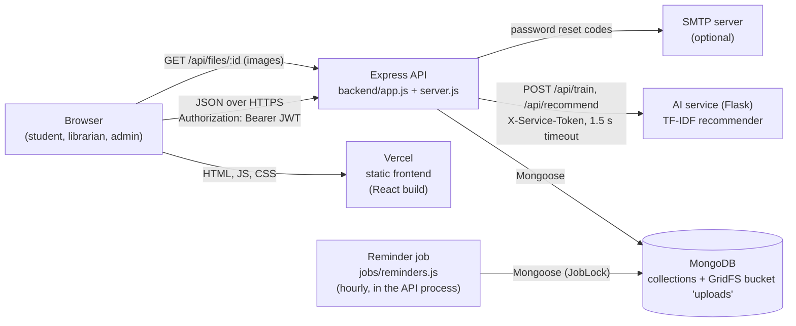
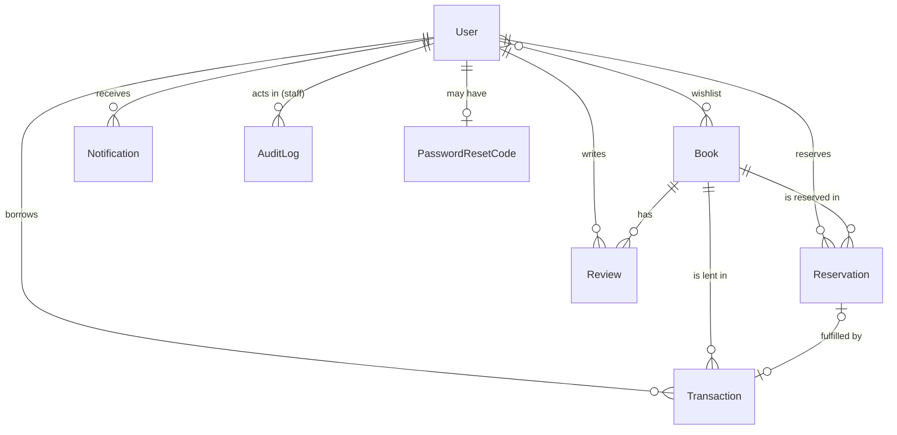
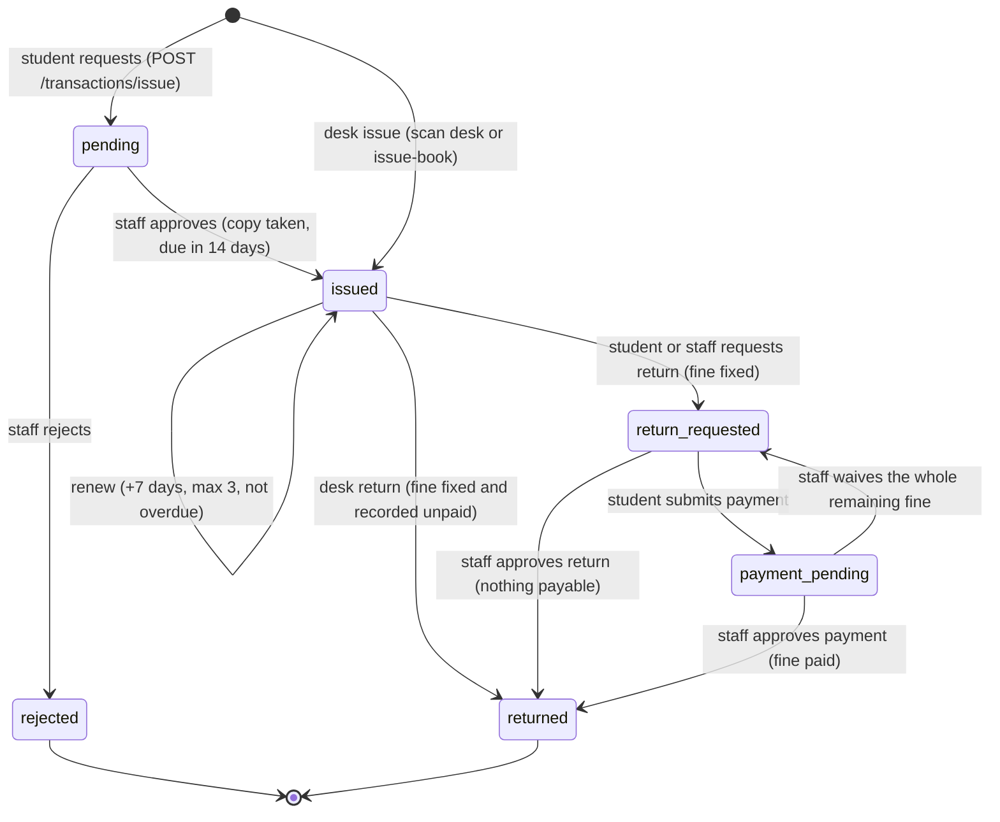
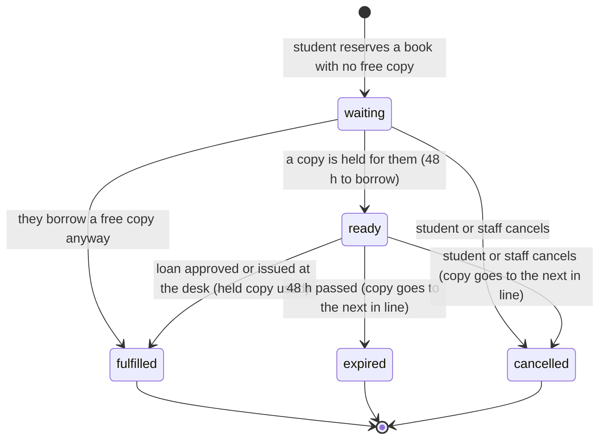
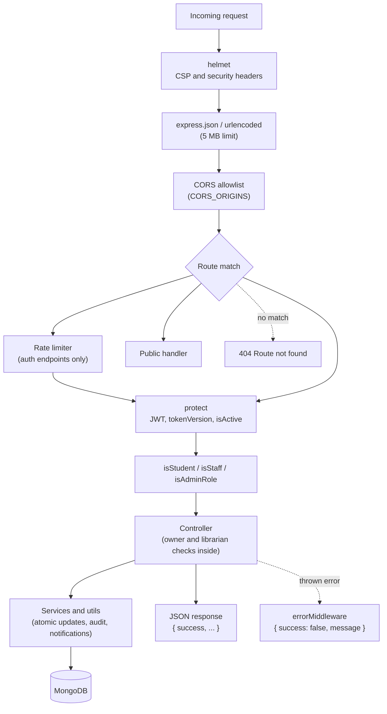

# LibVerse Architecture

A guide for developers new to the codebase: what runs where, how a request travels through the
backend, how the data is modelled, and where to look for each concern. The endpoint reference is in
[API.md](API.md).

## Overview

LibVerse is a library management system with three roles (student, librarian, admin) and three
deployable parts:

| Part | Folder | Stack | Hosted on |
|---|---|---|---|
| Web app | `frontend/` | React 18, Vite, Tailwind CSS, React Router, axios, ECharts | Vercel (static files, `frontend/vercel.json`) |
| API | `backend/` | Node.js, Express 4, Mongoose 7, JWT, helmet, express-rate-limit, multer + sharp | Render web service (`render.yaml`) |
| Recommendation service | `ai-service/` | Python, Flask, scikit-learn (TF-IDF) | Render web service (`render.yaml`) |

MongoDB (Atlas in production) is the only database. It also stores uploaded images in GridFS. The
recommendation service is optional: without it the API answers recommendations from MongoDB.



The browser never talks to the AI service or the database directly. The frontend is a single-page app
served from Vercel; it calls the API at `VITE_API_BASE_URL` (default `http://localhost:5001/api`).

## Backend layout

### Entry points

| File | Role |
|---|---|
| `backend/app.js` | Builds the Express app: trust proxy, helmet (CSP), JSON body limit (5 MB), CORS allowlist, route mounting, `GET /api/files/:id`, legacy `/uploads` static files, `GET /api/health`, error middleware, 404 handler. No database connection, no listening, no jobs, so tests import it directly. |
| `backend/server.js` | Process entry: loads `.env`, refuses to start without `JWT_SECRET`, connects MongoDB (`config/db.js`), listens on `PORT` (default 5001), starts the reminder job and trains the AI service once the database is open. |

### Folders

| Folder | What lives there |
|---|---|
| `config/` | `db.js` (MongoDB connection from `MONGODB_URI` or `MONGO_URI`), `security.js` (CSP directives shared with Vercel, helmet options, rate limiters) |
| `middleware/` | `authMiddleware.js` (`protect`, `isStudent`, `isStaff`, `isAdminRole`), `errorMiddleware.js` (maps Mongoose errors to `{ success: false, message }`) |
| `routes/` | One router per mount point; each line wires a path to middleware and a controller function |
| `controllers/` | Request handlers: validate input, call services and utils, shape the response |
| `services/` | Logic shared by several controllers or with an external dependency |
| `utils/` | Small pure helpers and atomic stock operations |
| `models/` | Mongoose schemas |
| `jobs/` | Background work inside the API process |
| `scripts/` | One-off maintenance and data scripts, run by hand with `node scripts/<name>.js` |
| `tests/` | Jest + Supertest suites against a real MongoDB (see [TESTING.md](TESTING.md)) |

Routes (`backend/routes/`):

| File | Mounted at |
|---|---|
| `authRoutes.js` | `/api/auth` |
| `bookRoutes.js` | `/api/books` |
| `transactionRoutes.js` | `/api/transactions` |
| `fineRoutes.js` | `/api/fines` |
| `adminRoutes.js` | `/api/admin` |
| `profileRoutes.js` | `/api/profile` |
| `notificationRoutes.js` | `/api/notifications` |
| `wishlistRoutes.js` | `/api/wishlist` |
| `reservationRoutes.js` | `/api/reservations` |

Controllers (`backend/controllers/`):

| File | Responsibility |
|---|---|
| `authController.js` | Signup, login, current user, profile fields, onboarding, favourite genres, password change |
| `passwordResetController.js` | Forgot password by emailed 6-digit code |
| `accountController.js` | "Me" endpoints: profile stats, recent activity, a student's reading stats |
| `bookController.js` | Catalogue listing, details, CRUD, reviews, popular books, stock summary, recommendations |
| `bookCoverUploadController.js` | Cover image upload (resized with sharp, stored in GridFS) |
| `bookImportController.js` | CSV import preview and import (logic in `bookImportService.js`) |
| `transactionController.js` | Loan lifecycle: request, approve, reject, return, renew, payment, waiver, staff lists |
| `fineController.js` | Payment screen data for a fine |
| `adminController.js` | Staff dashboard, user management, pending requests, reminders, desk issue/return by search, global search |
| `analyticsController.js` | Analytics, reports and the audit log (logic in `analyticsService.js`) |
| `deskController.js` | Scan desk: resolve a code, issue, return; library cards and card reissue |
| `userOverviewController.js` | Student 360 overview and "find a student" lookup |
| `notificationController.js` | Notification listing and read state; `createNotification`, `notifyStudent`, `notifyStaff` helpers used everywhere |
| `profileController.js` | Avatar upload with circular crop (GridFS) |
| `reservationController.js` | Reservation endpoints (logic in `reservationService.js`) |
| `wishlistController.js` | Wishlist add, remove, list |

Services (`backend/services/`):

| File | Responsibility |
|---|---|
| `reservationService.js` | Waiting lists: queue positions, holding returned copies for the next student (48 h), taking a copy for a loan, expiry, cancellation, "back in stock" alerts |
| `deskService.js` | `issueAtDesk` and `returnAtDesk`, shared by the scan desk and `POST /api/admin/issue-book` / `return-book` |
| `analyticsService.js` | Date-range parsing and every analytics and report number |
| `bookImportService.js` | CSV validation, duplicate detection, import, optional Open Library cover check |
| `recommendationService.js` | Client for the AI service: training, debounced retraining, recommend with timeout |
| `fileStore.js` | GridFS save, delete and `serveFile` for `GET /api/files/:id` |
| `mailer.js` | Nodemailer over SMTP; enabled only when all SMTP variables are set |

Utils (`backend/utils/`):

| File | Responsibility |
|---|---|
| `fineCalculator.js` | Calendar-day fines (₹5 per day), days late, payable and paid amounts |
| `loanRules.js` | `LOAN_DAYS` (14), `RENEWAL_DAYS` (7), `MAX_RENEWALS` (3), `FINE_PER_DAY` |
| `bookStock.js` | Atomic stock moves (take, return, hold, release, consume a held copy) and the restock alert flag |
| `libraryCard.js` | Desk QR codes: signed library card codes and book codes, parsing |
| `libraryId.js` | Sequential Library IDs (`LIB-1001` ...) from an atomic counter |
| `audit.js` | `audit()` writes an `AuditLog` entry (never throws, strips emails); `personLabel()` |
| `escapeRegex.js` | `escapeRegex`, `toQueryString` (plain strings only), `toPagination` |
| `isbn.js` | ISBN normalisation (digits only) and ISBN-13 check digit |
| `csvParse.js` | Dependency-free RFC 4180 CSV parser used by the import |

Jobs: `backend/jobs/reminders.js` (see [Background jobs](#background-jobs)).

Scripts (`backend/scripts/`):

| File | Purpose |
|---|---|
| `createAdmin.js` | Create an admin account from the terminal (`npm run create-admin`) |
| `resetPassword.js` | Set a new password for one user from the terminal |
| `exportCatalogue.js` / `importCatalogue.js` | Copy the catalogue to an empty database such as Atlas (`npm run catalogue:export` / `catalogue:import`) |
| `seedDemo.js` | Rebuild the `libverse_demo` database with fictional members and months of activity (uses `scripts/data/demo-catalogue.json`) |
| `seedDatabase.js` | Add missing books from `newBooksData.js` (idempotent, additive) |
| `newBooksData.js` | Book data used by `seedDatabase.js` |
| `expandCatalogue.js` | Add verified books from `scripts/data/catalogue-expansion.json` and fill empty descriptions from `description-backfill.json` (dry run unless `--apply`) |
| `verifyCatalogueCandidates.js` | Check candidate books against Open Library (network only) |
| `applyDescriptionRewrite.js` | Data clean-up: original descriptions, digits-only ISBNs, single `publicationYear` |
| `repairBooks.js` / `bookMetadata.js` | Fix Open Library cover URLs and fill missing book metadata (publisher, rating, pages, language) |
| `recountStock.js` | Recompute every book's stock counters from real loans and reservations |
| `migrateLibraryIds.js` | Move users to short sequential Library IDs |
| `migrateUploadsToGridFS.js` | Move images from `backend/uploads` into GridFS |

## Data model

All models are in `backend/models/`. Every collection uses MongoDB ObjectIds; references are stored
as ids and populated where needed.



| Model | Key fields | Notes |
|---|---|---|
| `User` | `name`, `email` (unique, lower-case), `password` (bcrypt, `select: false`), `role` (`student`/`librarian`/`admin`), `libraryId` (unique), `isActive`, `fineAmount` (running total of fixed unpaid fines), `tokenVersion`, `cardVersion`, `wishlist` (Book ids), `favoriteGenres`, `isOnboardingCompleted`, `phone`, `address`, `profileImage` | Password hashed in a `pre('save')` hook |
| `Book` | `title`, `author`, `genre` (enum of 18 genres), `isbn` (digits only, unique sparse), `publisher`, `publicationYear`, `description`, `pages`, `language`, `rating`, `totalCopies`, `availableCopies`, `issuedCopies`, `heldCopies`, `restockAlertPending`, `coverImage`, `imageUrl`, `location`, `isActive` | Deleting a book sets `isActive: false`. `qrCode` is a legacy field that is no longer written |
| `Transaction` | `userId`, `bookId`, `status`, `issueDate`, `dueDate`, `returnDate`, `renewalCount`, `fineAmount`, `finePaid`, `fineWaived`, `waiverReason`, `waivedBy`, `waivedAt`, `approvedBy`, `approvalDate`, `returnRequestedAt`, `returnApprovedBy`, `paymentScreenshot`, `paymentSubmittedAt`, `paymentApprovedBy`, `paymentApprovedAt`, `remindersSent.{dueSoon,overdue}` | One request or loan of one book by one student |
| `Reservation` | `userId`, `bookId`, `status`, `readyAt`, `expiresAt`, `fulfilledTransactionId`, `cancelledBy` | Unique partial index: one active (`waiting`/`ready`) reservation per student and book |
| `Review` | `userId`, `bookId`, `rating` (1-5), `comment` (max 500) | `Book.rating` is the rounded average |
| `Notification` | `userId`, `role`, `type` (enum), `title`, `message`, `isRead`, `link`, `meta.{transactionId,bookId}` | Virtuals `notificationId` and `category` |
| `AuditLog` | `actorId`, `actorRole`, `action` (enum), `targetType`, `targetId`, `summary` (max 300, no emails), `meta` | Written by `utils/audit.js` |
| `PasswordResetCode` | `userId` (unique), `codeHash` (HMAC), `expiresAt`, `attempts` | TTL index deletes it at `expiresAt` |
| `Counter` | `_id` (sequence name), `seq` | Used for Library IDs |
| `JobLock` | `_id` (job name), `lastRunDay`, `lastRunHour`, `lastRunAt`, `lastResult` | Makes scheduled runs happen once per period across servers |

### Stock invariant

Every book keeps four counters with one invariant:

```text
availableCopies + issuedCopies + heldCopies === totalCopies   (none negative)
```

- `availableCopies`: on the shelf, free for anyone.
- `issuedCopies`: on loan (`issued`, `return_requested` or `payment_pending`).
- `heldCopies`: set aside for a `ready` reservation; only that student can borrow it.

MongoDB may run standalone (no multi-document transactions), so every stock change is one
conditional `findOneAndUpdate` in `backend/utils/bookStock.js` that checks and changes in the same
step, for example "take a copy only if `availableCopies > 0`". A returned copy goes from issued
straight to held when someone is waiting, so it is never free in between. Staff edits of the counts
are validated against the invariant and applied only if the counts did not move meanwhile.
`backend/scripts/recountStock.js` recomputes the counters from real loans and reservations, and the
circulation tests assert the invariant after every scenario.

### Transaction lifecycle



Notes:

- The fine grows while `issued` (₹5 per calendar day late) and is frozen in `fineAmount` at the
  return request or desk return.
- **Waivers** do not change the status except in one case: staff may waive part or all of a fixed,
  unpaid fine on a `return_requested`, `payment_pending` or `returned` loan. A full waiver makes the
  return approvable; on a `payment_pending` loan it moves the loan back to `return_requested`, since
  there is no payment left to verify. A fine recorded at a desk return (status already `returned`)
  stays payable until it is waived.
- Every transition is a conditional update on the current status, so two staff members clicking at
  once cannot both apply it.
- `overdue` exists in the schema's status enum for older data but no code path sets it; overdue is
  computed from `dueDate`.

### Reservation lifecycle



Removing a book from the catalogue cancels all its active reservations.

## Request flow



1. **helmet** (`backend/config/security.js`): a Content-Security-Policy that allows only the app's own
   scripts, Google Fonts, HTTPS images and the API origins in `CSP_API_ORIGINS` (default
   `http://localhost:<PORT>`), plus `frame-ancestors 'none'`, a strict referrer policy and a
   cross-origin resource policy that lets the frontend show API-served images. The same directives
   are written into `frontend/vercel.json` for the static site; a test keeps the two in sync.
2. **CORS**: only origins listed in `CORS_ORIGINS` (default `http://localhost:3000` and
   `http://127.0.0.1:3000`) get CORS headers. Requests without an `Origin` header (curl,
   server-to-server) are allowed.
3. **Rate limits** on login (failed attempts only), signup, password change, forgot password and
   reset password, per client IP (`TRUST_PROXY` behind a proxy).
4. **`protect`** verifies the JWT, loads the user, rejects tokens issued before the last password
   change or reset (`tokenVersion`) and deactivated accounts.
5. **Role checks** (`isStudent`, `isStaff`, `isAdminRole`) on the route, then finer rules in the
   controller: owner-or-staff on loans and reservations, librarians limited to student accounts.
6. Controllers read only plain string inputs for queries (`toQueryString`), escape user text used in
   regular expressions, and answer `{ success, ... }`. Side effects that must never fail the main
   action (notifications, audit entries, the AI service) are wrapped so their errors are only logged.

## Recommendations

Two halves: a Node client with a fallback, and a stateless Python ranker.

**Node side (`backend/services/recommendationService.js`, used by `GET /api/books/recommendations`)**

- Enabled only when `AI_SERVICE_URL` and `AI_SERVICE_TOKEN` are both set; every call sends
  `X-Service-Token`.
- **Training**: `trainOnStartup()` sends the whole active catalogue (id, title, author, genre,
  description, borrow count as popularity) once MongoDB is connected, retrying after 2 s, 5 s, 15 s,
  30 s, 60 s and 120 s if the service is not up yet. Creating, editing, deleting or importing books
  calls `scheduleRetrain()`, debounced (default 5 s, `AI_RETRAIN_DEBOUNCE_MS`) so a burst of edits
  causes one retrain. A `409` from the service (it restarted and lost its catalogue) triggers a
  retrain too.
- **Recommending**: the controller sends the reader's read book ids, favourite genres and the ids to
  exclude (anything requested, borrowed or reserved), with a **1.5 s timeout**. It re-reads the
  returned ids from MongoDB so only active books with current stock are shown.
- **Fallback**: if the service is unconfigured, down, slow or untrained, or returns fewer than 6
  books, the remaining slots come from MongoDB: top-rated books in the favourite genres, then top-rated
  books overall. Each book carries `recommendationSource` (`ai` or `fallback`) and
  `recommendationReason`; the response's `source` is `ai` when at least one AI pick was used.

**Python side (`ai-service/`)**

- `model/recommender.py`: word-level TF-IDF with unigrams and bigrams, English stop words and
  sublinear term frequency over a document per book built in `utils/preprocess.py` from title,
  author, genre and description (title and genre counted twice). Similarity is cosine similarity.
- Ranking: a candidate similar enough (cosine at least 0.05) to a book the reader read scores its
  best similarity, plus 0.15 if it is in a favourite genre, with the reason "Because you read
  <title>". Other books in a favourite genre rank below every content match, ordered by popularity,
  with the reason "Popular in <genre>". Read and excluded books are skipped.
- The service keeps only the last trained catalogue (swapped atomically under a lock). Everything
  about the reader arrives with each request, so it holds no user data.
- Endpoints: `POST /api/train`, `POST /api/recommend` (both need `X-Service-Token`) and `GET /health`.

## Background jobs

`backend/jobs/reminders.js` runs inside the API process, with no external scheduler.
`startReminderJob()` (called from `server.js`) runs a tick once MongoDB is connected and then every
hour. Each tick does two things:

| Task | Lock | What it does |
|---|---|---|
| Reservation expiry | `JobLock` `reservation-expiry`, once per clock hour (`lastRunHour`) | Expires `ready` reservations past `expiresAt`, releases the held copy, notifies the student and passes the copy to the next in line. Always runs. |
| Loan reminders | `JobLock` `reminders`, once per calendar day (`lastRunDay`) | `DUE_DATE_REMINDER` once for loans due within 2 days (reset when a loan is renewed); `BOOK_OVERDUE` on the first overdue day and then at most every 7 days, with the current fine. Off when `REMINDERS_ENABLED=false`. |

A `JobLock` document is claimed with an atomic upsert, so with several API instances only one runs
each period. Each loan is also claimed (`remindersSent.<kind>`) before it is notified, so the staff
"Send reminders" button (`POST /api/admin/send-reminders`, which skips the daily lock) never sends
duplicates. Reservation lists also expire overdue holds before they are read.

## Frontend structure

`frontend/src/`:

| Path | Contents |
|---|---|
| `main.jsx` | Mounts `<App />` |
| `App.jsx` | Router, providers, splash screen, every route. Each page is loaded with `React.lazy` so it is its own chunk, with a skeleton fallback that keeps the sidebar and navbar in place |
| `pages/` | One component per screen (for example `Books.jsx`, `MyBooks.jsx`, `PendingRequests.jsx`, `ScanDesk.jsx`, `StudentOverview.jsx`, `ImportBooks.jsx`, `Analytics.jsx`, `Reports.jsx`, `AuditLog.jsx`) |
| `components/` | Shared UI (`BookCard`, `Navbar`, `Sidebar`, `ProtectedRoute`, `LibraryCard`, `QrCode`, modals) and feature folders `analytics/`, `dashboard/`, `desk/`, `profile/`, `staff/` |
| `layouts/` | `MainLayout.jsx`: sidebar plus navbar around signed-in pages |
| `context/` | `AuthContext.jsx` (token and user in `localStorage`, refreshed from `/auth/me` on load), `NotificationContext.jsx` (unread count and list, refreshed every 60 s while the tab is visible and on focus) |
| `hooks/` | `useAuth`, `useNotification`, `useWishlist`, `useReservations`, `useActiveBookIds`, `useDebounce`, `useQrScanner` |
| `services/api.js` | The single axios client: base URL from `VITE_API_BASE_URL`, adds the Bearer token, signs out on a 401 or "Account is deactivated"; grouped helpers (`authAPI`, `booksAPI`, `transactionsAPI`, `adminAPI`, `deskAPI`, ...) |
| `utils/` | Fine calculator mirroring the backend, date helpers, CSV export, ECharts setup, QR encode/decode/layout, library card artwork, asset URLs for `/api/files/<id>` |
| `constants/` | Genre list and audit action labels |
| `styles/` | `index.css` (Tailwind) |

Routes are grouped by role and guarded by `ProtectedRoute`, which redirects a user with another role
to their own home and sends students without completed onboarding to `/student/onboarding`:

| Prefix | Role | Examples |
|---|---|---|
| `/login`, `/signup`, `/forgot-password` | Public | |
| `/student/...` | student | `dashboard`, `books`, `books/:id`, `my-books`, `wishlist`, `fines`, `pay-fine/:fineId`, `notifications`, `profile` |
| `/librarian/...` | librarian | `/librarian` (dashboard), `books`, `books/add`, `books/import`, `books/labels`, `scan`, `users`, `users/:id`, `pending`, `issue-return`, `analytics`, `reports` |
| `/admin/...` | admin | Everything the librarian has, plus `/admin/audit` |

The route guard is a convenience for the UI only; every permission is enforced again by the API.

## Security summary

- **Authentication**: bcrypt password hashes; JWT with a `tokenVersion` claim so a password change or
  reset ends older sessions; deactivated accounts are refused on every request; `JWT_SECRET` is
  required at start-up.
- **Authorisation**: role middleware on routes plus owner and librarian checks in controllers; the
  last active admin cannot be demoted or deactivated; the audit log is admin-only.
- **Input handling**: query values must be plain strings (no Mongo operators), user text is
  regex-escaped, signup ignores `role`, uploads are limited by type and size and re-encoded with sharp.
- **HTTP**: helmet with an app-specific CSP (mirrored on Vercel), CORS allowlist, rate limits on the
  auth endpoints, `x-powered-by` disabled.
- **Secrets and privacy**: password reset codes stored as HMACs; library card QR codes signed with a
  key derived from `JWT_SECRET`; the AI service requires a shared token; audit summaries and search
  results never include emails; email and SMTP errors are logged without recipients.
- **Consistency**: stock, loan and reservation changes are single conditional updates, so concurrent
  requests cannot double-lend or double-count.

## Testing and CI

- Test suites and how to run them: [TESTING.md](TESTING.md) (backend Jest + Supertest against a real
  MongoDB, AI service pytest, frontend build).
- CI: `.github/workflows/ci.yml` runs backend tests with a MongoDB 7 service container, the frontend
  build and the AI service tests on every push and pull request.

## Deployment

- Step-by-step guide: [DEPLOYMENT.md](../DEPLOYMENT.md) (MongoDB Atlas, Render, Vercel, optional SMTP).
- `render.yaml`: Render Blueprint for the API (`backend/`, health check `/api/health`) and the
  recommendation service (`ai-service/`, health check `/health`); environment variables are listed
  by name only.
- `frontend/vercel.json`: Vite build, SPA rewrite to `index.html`, long cache for hashed assets, and
  security headers including the CSP.
